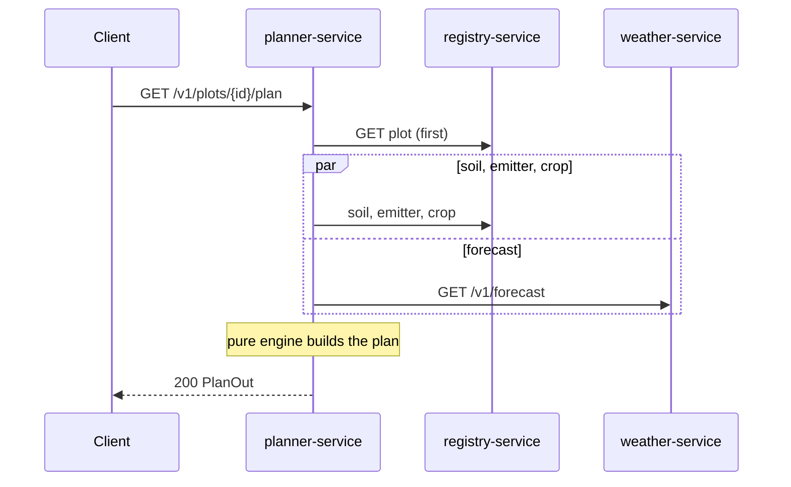

# planner-service

Irrigation plan for a plot (FastAPI, port 8002): for each of the next 1 to 7 days, the weather, the crop factor, the soil bucket, and the litres and minutes to run the drip system. It asks registry-service for the plot, soil and emitter, and weather-service for the forecast. It computes every number itself, with the pure FAO-56 engine (see `.claude/skills/irrigation-calc-reference/SKILL.md`). No AI model computes or adjusts a number. If an upstream is down or answers something unexpected, it returns an error, never a partial or default plan.

`GET /v1/plots/{id}/plan?days={days}&bucket_start={bucket_start}` (`days` 1..7, default 7; `bucket_start` 0..1, default 1.0), `GET /v1/plots/{id}/bucket-suggestion?last_irrigation=YYYY-MM-DD` and `GET /health`.

## Run

Needs registry-service on port 8000 and weather-service on port 8001.

```bash
cd services/planner-service
cp .env.example .env
uv sync
uv run uvicorn main:app --port 8002
uv run pytest -W error -q
```

The test run gives 455 passed. The tests use fakes only: they never call the real registry, weather or Open-Meteo, and never touch a database.

## Settings

Read from `.env`. Only the keys below are allowed: an unknown key (a typo too) stops the service at startup.

| Key | Required | Default | Meaning | Valid range |
| --- | --- | --- | --- | --- |
| `REGISTRY_URL` | yes | none (example `http://127.0.0.1:8000`) | registry-service base URL | non-empty, starts with `http://` or `https://` |
| `WEATHER_URL` | yes | none (example `http://127.0.0.1:8001`) | weather-service base URL | non-empty, starts with `http://` or `https://` |
| `REGISTRY_TIMEOUT_SECONDS` | no | `3` | whole registry call | finite, above 0 |
| `WEATHER_TIMEOUT_SECONDS` | no | `6` | whole weather call | finite, above 0, **above `WEATHER_REFRESH_DEADLINE_SECONDS`** |
| `MAX_DAILY_RUN_MINUTES` | no | `1440` | daily cap on one plot's run; a refill beyond it continues on the following days | integer 1..1440 |
| `DEPLETION_FRACTION_OVERRIDE` | no | unset (each crop keeps its own p) | replaces the depletion fraction p for every crop | 0..1 when set; an empty value is an error |
| `WEATHER_REFRESH_DEADLINE_SECONDS` | no | `5` | weather-service's refresh deadline; keep it equal to weather-service's value | finite, above 0 |
| `RETRY_AFTER_SECONDS` | no | `5` | `Retry-After` of a 503 when the upstream sent none | integer, at least 1 |
| `UPSTREAM_MAX_CONNECTIONS` | no | `20` | most open connections to registry-service and weather-service together (connections, not seconds); the keep-alive count is 10, or this value when it is lower | integer, above 0 |

If `UPSTREAM_MAX_CONNECTIONS` is too low, requests wait for a free connection. The wait counts against the call's timeout, so a request can end as a 503 that blames the wrong service (for example registry-service, while the connections are held by slow weather calls). One plan request uses up to 4 connections.

Startup check: the service refuses to start when `WEATHER_TIMEOUT_SECONDS` is not above `WEATHER_REFRESH_DEADLINE_SECONDS`. Otherwise a weather call could be cut off before weather's own deadline answer (stale data or a 503) arrives.

## Endpoints

- `GET /v1/plots/{id}/plan?days=1..7&bucket_start=0..1`: the plan. Values outside the ranges give 422.
- `GET /v1/plots/{id}/bucket-suggestion?last_irrigation=YYYY-MM-DD`: the soil bucket level at the start of today, computed from the date of the last irrigation.
- `GET /health`: `{"status": "ok"}`. Calls no upstream.

An unknown route gives 404 `NOT_FOUND`. A wrong method gives 405 `VALIDATION`.

## Examples

Captured from a live run of the three services (registry, weather, planner) on 2026-11-18. Arrays are shortened to the first days shown.

**a. Plan, `days=2`, a new tomato plot planted 30 days earlier**

```json
{"plot_id":"02b93842-d7aa-4857-bd52-7c56e237fc3f","crop":"tomato","bucket_start":1.0,
 "fetched_at":"2026-11-18T11:35:00Z","stale":false,"days":[
 {"date":"2026-11-18","stage":"dev","et0_mm":2.76,"rain_mm":0.0,"kc":0.6138,
  "litres":0,"run_minutes":0,"bucket_mm":70.81,"bucket_capacity_mm":72.5,"stale":false},
 {"date":"2026-11-19","stage":"dev","et0_mm":3.07,"rain_mm":0.0,"kc":0.6275,
  "litres":0,"run_minutes":0,"bucket_mm":70.13,"bucket_capacity_mm":73.75,"stale":false}]}
```

**b. The same plot with `bucket_start=0.5`**

The first day has `"litres":37944,"run_minutes":1366,"bucket_mm":72.5`: the irrigation refills the bucket. The next day has `bucket_mm` 71.82.

**c. A seed plot, season ended**

Every day has `"stage":"ended","kc":null,"litres":0,"run_minutes":0,"bucket_mm":null,"bucket_capacity_mm":null`. `et0_mm` and `rain_mm` are still shown.

**d. Bucket suggestion**

```json
{"plot_id":"02b93842-d7aa-4857-bd52-7c56e237fc3f","last_irrigation":"2026-11-08",
 "suggestion":0.762,"exact":true,"reason":null,"past_days_requested":9,
 "past_days_returned":9,"stale":false}
```

Season ended (same shape, `suggestion` null):

```json
{"suggestion":null,"exact":false,"reason":"season_ended","past_days_requested":0}
```

**e. Errors**

Every error is `application/problem+json` with exactly the fields `type`, `title`, `status`, `detail`, `code`. These two are captured from a live run on 2026-11-18 (manual test scenarios 5 and 7):

```json
{"type":"about:blank","title":"Not Found","status":404,"detail":"Plot not found","code":"NOT_FOUND"}
```

```json
{"type":"about:blank","title":"Service Unavailable","status":503,"detail":"weather-service is unavailable","code":"UPSTREAM_UNAVAILABLE"}
```

The 503 also carries a `Retry-After` header.

## Errors

| Status | HTTP meaning | Code | When |
| --- | --- | --- | --- |
| 404 | Not found | `NOT_FOUND` | The plot is not in the registry (client error). |
| 422 | Invalid client input | `VALIDATION` | A bad `days`, `bucket_start` or `last_irrigation`, or a date rule of the suggestion (see below). Also a crop with no irrigation coefficients: a data problem in the planner, not a request problem. |
| 503 | Service unavailable | `UPSTREAM_UNAVAILABLE` | Connection error, timeout or 5xx from registry-service or weather-service. The `detail` names the service. `Retry-After` is weather's value (capped at 3600) when weather sent one, else `RETRY_AFTER_SECONDS`. |
| 500 | Internal server error | `INTERNAL` | Our bug, or an unexpected upstream answer (wrong JSON, missing field, non-finite number, wrong day count). No details in the body; they go to the log. |

## Bucket suggestion: check order

`last_irrigation` is checked in this fixed order (design 5.4). A failed check stops the request.

1. The value must be a valid `YYYY-MM-DD` date and not later than the latest date on Earth (UTC+14). Checked before any upstream call: "cannot be in the future" (422).
2. Fetch the plot from registry: 404 if missing, 503 if registry is down.
3. One weather call gives "today". If the season has ended: 200 with `reason: "season_ended"`. This check wins over the next one.
4. The date must be on or after planting, not more than 92 days back, and not after the point's local today. Failing this gives 422 "is in the future" (a near future date, within the UTC+14 margin). The far future check (step 1) gives "cannot be in the future". The two wordings come from two different steps.
5. Otherwise the calculation (I22). If the last irrigation was today or yesterday: `suggestion` 1.0, `exact: true`, no past days requested. Otherwise the planner simulates the past days weather returned:
   - All requested past days returned: the exact simulation, `exact: true`.
   - Fewer returned, at least one: the bucket is assumed full at the start of the first returned day (an optimistic bound). If that run reaches empty on any day, `exact: true` with the value of the run. If it never does, `suggestion: null`, `exact: false`, `reason: "insufficient_past_weather"`.
   - None returned: `suggestion: null`, `exact: false`, `reason: "insufficient_past_weather"`.

"Today" comes from the weather answer, not from the planner's clock. So if weather is down, the answer is 503 even for an ended plot.

## Demo note

The four seed plots are past their season end, so a live plan for them shows `"stage":"ended"` and zeros. To see real numbers, create a new plot in registry with a planting date about 30 days ago. The `farm_id`, `crop_id`, `soil_id` and `emitter_id` below are the ids from the seed (`services/registry-service/seed_registry.sh`), with the same values as the North block:

The date command is GNU `date` (Linux or WSL):

```bash
PLANT=$(date -d '30 days ago' +%F)
curl -s -X POST http://127.0.0.1:8000/v1/plots -H 'Content-Type: application/json' -d '{
  "farm_id":"b7e2c0a0-3c1d-4f0a-9a11-0c5d2e6f1001","name":"Demo plot","area_m2":1000,
  "crop_id":"tomato","planting_date":"'"$PLANT"'","soil_id":"loam",
  "row_spacing_m":1.5,"emitter_spacing_m":0.4,"emitter_id":"dripnet-pc-1.0",
  "lat":31.25,"lon":34.79}'
```

Use the `id` in the response for the plan.

## Known limitations

- A very long `Retry-After` digit string (more than 4,300 digits) raises `ValueError` in the planner, which gives a 500.
- `isdecimal()` accepts non-ASCII digits, which `int()` then reads too.
- The daily cap (`MAX_DAILY_RUN_MINUTES`) is covered by unit tests only. It was not exercised in the manual run above.
- The worst-case planner call takes about 9 s (3 s registry plus 6 s weather). A frontend timeout must be larger.
- The frontend must show "season ended" for `stage: "ended"`, not "no irrigation today". A zero `run_minutes` there means the season is over.
- Open-Meteo does not have all 92 past days. On the check of 2026-11-17, weather-service had 67 of them, and the oldest requested days were missing. It then answers 200 with fewer days and a `past_days_returned` field. For a `last_irrigation` older than the days it can supply, the suggestion is exact if the optimistic run reaches empty (see check order, step 5), else `suggestion: null` with `reason: "insufficient_past_weather"`.

## Request flow


