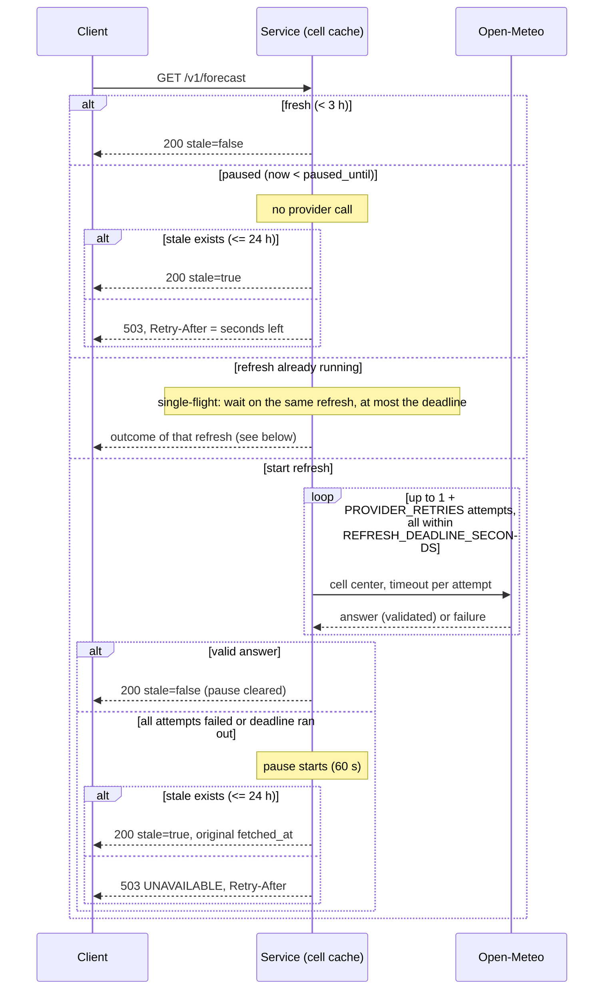

# weather-service

Daily forecast (ET0 and rain, in mm) for AgroPilot (FastAPI, port 8001). It asks Open-Meteo, keeps the answer in memory by 0.1 degree cell, and never makes up a number the provider did not give.

`GET /v1/forecast?lat={lat}&lon={lon}&days={days}` (`days` 1..7, default 7) and `GET /health` (never calls the provider).

## Run

```bash
cd services/weather-service
uv sync
cp .env.example .env
uv run uvicorn main:app --host 127.0.0.1 --port 8001
uv run pytest
```

Run **one worker process** (no `--workers`, no multiple replicas). The cache, the single-flight and the failure pause live in the memory of the process. With several workers each would call the provider on its own and the pause would not be shared.

## Settings

Read from the environment first, then from `.env`. Only these keys are allowed: an unknown key in `.env` (a typo too) stops the service at startup.

| Key | Required | Default | Meaning |
| --- | --- | --- | --- |
| `PROVIDER_BASE_URL` | yes | none (example `https://api.open-meteo.com/v1/forecast`) | Forecast endpoint. |
| `PROVIDER_API_KEY` | no | empty | Sent as `apikey` only when not empty. Never logged. |
| `PROVIDER_ATTEMPT_TIMEOUT_SECONDS` | no | `1.5` | Timeout of one attempt. |
| `PROVIDER_RETRIES` | no | `2` | Retries after the first attempt (3 attempts in total). |
| `PROVIDER_RETRY_BACKOFF_SECONDS` | no | `0.2` | Constant wait between attempts. |
| `REFRESH_DEADLINE_SECONDS` | no | `5` | Bounds all attempts of one refresh together, and every wait on it. |
| `FORECAST_FRESH_SECONDS` | no | `10800` (3 h) | A fresh forecast is served without calling the provider. |
| `FORECAST_MAX_STALE_SECONDS` | no | `86400` (24 h) | A forecast older than this is never served. |
| `FAILURE_PAUSE_SECONDS` | no | `60` | After a failed refresh, no provider call for this long. |
| `RETRY_AFTER_SECONDS` | no | `5` | `Retry-After` of a 503 outside a pause. |

The service refuses to start when `PROVIDER_BASE_URL` is missing or empty, when `PROVIDER_ATTEMPT_TIMEOUT_SECONDS >= REFRESH_DEADLINE_SECONDS` (one attempt would eat the budget and retries would never happen), when a value is negative or not finite, or when `FORECAST_FRESH_SECONDS > FORECAST_MAX_STALE_SECONDS`.

## Open-Meteo

Checked against the documentation on 2026-11-15:

- Daily variables `et0_fao_evapotranspiration` (daily sum of reference evapotranspiration of a well watered grass field, mm) and `precipitation_sum` (mm). Docs: https://open-meteo.com/en/docs
- The response has `daily_units` with the unit of each variable. The service accepts the answer only if both units are `mm`.
- `timezone=auto` resolves the time zone from the coordinates, and the docs say `timezone` is required when daily variables are requested. The service keeps the time-zone name from the response and computes the point's local "today" with it, so "today" stays right across DST changes.
- `apikey` is for commercial use. Paying customers call the host `customer-api.open-meteo.com` with `&apikey=...`; apart from the host and the key the request is identical. Docs: https://open-meteo.com/en/docs and https://open-meteo.com/en/pricing. To use it: `PROVIDER_BASE_URL=https://customer-api.open-meteo.com/v1/forecast` and `PROVIDER_API_KEY=<key>`.

The service asks for `forecast_days=8` and for the **center** of the 0.1 degree cell, so the content of a cell never depends on which request came first.

### Why negative values are rejected, and the risk

Neither rain nor ET0 can physically be below zero, so a negative value is treated as bad provider data (provider failure), like `null`, a non-number, a wrong unit or a wrong length. A real `0.0` is valid. The risk: daily ET0 can, rarely, come out slightly negative on cold, humid nights (condensation). If that happens, the cell falls back to the stale forecast or to 503, instead of serving that value.

### Why `precipitation_sum` and not `rain_sum`

`precipitation_sum` is the daily sum of all precipitation: rain, showers and snowfall. `rain_sum` is rain only. For irrigation, all water that reaches the soil counts, so `rain_mm` is `precipitation_sum`.

## Freshness and failures

- **Fresh** (under 3 h): served from memory, no provider call.
- **Stale** (up to 24 h, `FORECAST_MAX_STALE_SECONDS`): served with `"stale": true` and its original `fetched_at` when a refresh fails. Irrigation decisions are daily. After a day the forecast may miss a change such as new rain, and a plan built on it could water a field that rain already watered, or skip one that needs water. Older than 24 h: `503 UNAVAILABLE`, never the old forecast. (The service asks for 8 days, so a 24 h old forecast still has 7 full days, except across a DST change, when two days can drop and `days=7` is a 503.)
- **One refresh deadline** (`REFRESH_DEADLINE_SECONDS`, 5 s) bounds all attempts and backoffs of one refresh, and requests waiting on the same refresh (single-flight) wait no longer. The planner's timeout will be set above it, so a stale forecast or a 503 always arrives in time.
- **The pause is a deliberate deviation from the letter of FR-2.6**, which reads as "every request retries twice, then serves stale". After a failed refresh of a cell (all attempts failed or the deadline ran out), for `FAILURE_PAUSE_SECONDS` (60 s) requests for that cell get the stale forecast at once, or a 503 if there is none usable, without calling the provider. Reason: the planner has its own timeout. If every request waited for three attempts while the provider is down, the planner would give up first and FR-2.13 (a stale forecast still gives a plan) would break. After the pause, one request tries again.
- **`Retry-After`** of a 503 during the pause is the seconds left in it (rounded up, at least 1), so right after a failure it is 60. Outside a pause it is `RETRY_AFTER_SECONDS` (5).
- **A bug never starts the pause.** Only provider failure or a deadline starts it. Any other exception stays a 500 on every request, so a bug is not hidden as an outage.
- **First day must be today.** The first served day must be exactly the point's local today; if the provider's first day is later (its clock slightly ahead around midnight), or fewer than `days` remain, the answer is a 503 with `RETRY_AFTER_SECONDS` that starts no pause and heals by itself.

Decisions: `docs/judgment-log.md`, entries 32-37.



## Known limitations

- **The cache is unbounded** (a known limitation: one entry per cell, no eviction). Requests with random coordinates could grow memory. Fine for the planner's use (a few plots); a limit is future work.
- One worker process only (see Run).

## NFR-2.3 measurement

Goal: a fresh forecast p95 of 100 ms or less at 10 requests per second, with **zero** calls to Open-Meteo.

Approach:

- A local fake provider (own port) returns a valid 8-day Open-Meteo-shaped answer for any point and counts its calls. The service runs against it (`PROVIDER_BASE_URL` set by the runner), one worker, no reload.
- Cache warm-up first: one request per point, all must be 200 with `stale: false`.
- Then three Poisson runs at 10 requests per second (seeds 1-3). PASS only if all three pass; the load tool also checks generator lag.
- Then the zero-calls check: the fake provider's call count must not change between the end of the warm-up and the end of the last run, otherwise the session fails.
- A progress display (overall bar with elapsed time and ETA, a status line with the phase, phase changes logged with timestamps) runs in the runner, outside the load tool, and does not affect the measurement.

Command, from `services/weather-service`:

```bash
uv run python perf/run_session.py --prefix official
```

Options: `--warmup` and `--duration` (load warm-up and measurement seconds). Results go to `perf/results/` (not committed), and an existing prefix is never overwritten.

## Results (NFR-2.3)

Session `official`, commit `8e96a2a`: three Poisson runs at 10 requests per
second (seeds 1-3), 20 s load warm-up and 300 s measurement each, against the
local fake provider. **NFR-2.3: PASS** (`run_session.py` exit 0).

| | Value |
| --- | ---: |
| Worst p95 | 10.6 ms (run 3, point 31.26/34.80) |
| Overall p95, seeds 1 / 2 / 3 | 9.9 / 9.8 / 10.3 ms |
| Runs passing | 3 of 3 |
| Errors | 0 in 8,870 requests |
| VM suspensions | 0 |
| Generator lag p99 | <= 3.3 ms in every run (limit 10 ms) |
| Provider calls | 3 during the cache warm-up, **0** during the runs |

- The warm-up made 3 provider calls for 4 points because 31.40/34.60 and
  31.41/34.61 fall in the same 0.1° cell. The zero-calls check passed: every
  measured request was a fresh forecast served from the cache.
- Run 3 had one short machine hiccup (p99 31.8 ms, max generator lag 97 ms).
  The run stayed valid, because its lag p99 was within the limit.
- The progress display reached 100 %, and the phase log recorded every phase.
